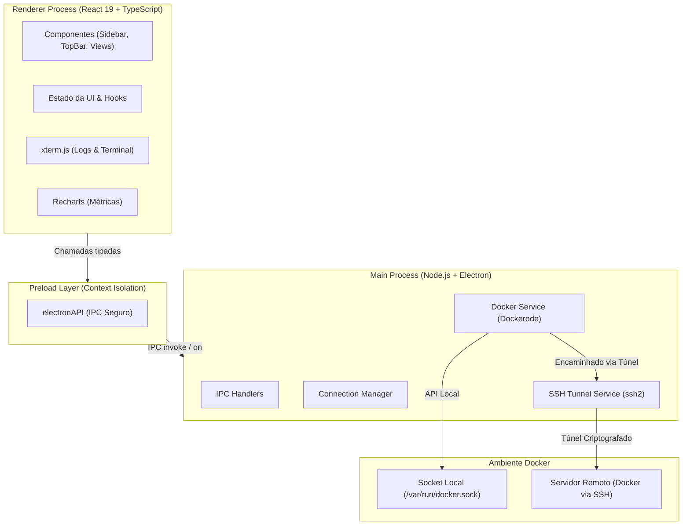

# DockDeck 🐳

> **Cliente desktop moderno, leve e multiplataforma para gerenciamento de containers Docker locais e remotos (via túnel SSH), combinando a agilidade do *lazydocker* com uma interface visual rica e intuitiva.**

---

[](https://www.electronjs.org/)
[](https://react.dev/)
[](https://www.typescriptlang.org/)
[](https://tailwindcss.com/)
[](https://docs.docker.com/engine/api/)
[](LICENSE)

---

## 💡 A Ideia

O **DockDeck** nasceu da necessidade de uma ferramenta que una o melhor de dois mundos: a agilidade, leveza e controle por teclado de ferramentas TUI (como o *lazydocker*) com a conveniência visual, gráficos dinâmicos e recursos interativos de uma aplicação desktop moderna.

Muitas ferramentas existentes para Docker pecam por dois extremos: ou são pesadas demais e exigem recursos excessivos da máquina, ou são exclusivamente de terminal, o que dificulta a análise detalhada de gráficos de métricas e inspeções extensas de JSON.

O **DockDeck** resolve esse problema ao fornecer:
1. **Consumo Enxuto de Recursos**: Construído com foco em performance e tempo de resposta imediato.
2. **Suporte Nativo a Ambientes Remotos**: Conecte-se com segurança a instâncias Docker rodando em servidores em nuvem ou VPS via túnel SSH criptografado sem precisar expor a porta da Docker Engine diretamente para a internet.
3. **Fluxo Otimizado para Teclado**: Navegação por atalhos rápidos pensada para o dia a dia de desenvolvedores e times de DevOps.

---

## ✨ Funcionalidades

### 🌐 Gestão Multi-Host (Local & SSH)
- **Detecção Local Automática**: Conecta diretamente ao socket Docker local (`/var/run/docker.sock` em Linux/macOS ou Named Pipe no Windows).
- **Túneis SSH Transparentes**: Gerenciador de perfis para servidores remotos usando `ssh2`. Autenticação por chave privada (com/sem passphrase) ou senha, sem necessidade de softwares adicionais.
- **Alternância Instantânea**: Troque entre servidores locais e de produção com um clique.

### 📊 Métricas & Telemetria em Tempo Real
- **Painel em Grade 2x2**: Acompanhe simultaneamente o consumo de **CPU**, **Memória**, **I/O de Rede** e **I/O de Disco**.
- **Histórico e Intervalos Flexíveis**: Seletores de período para análise rápida de tendências (últimos minutos, 3 dias, 1 semana).
- **Gráficos Fluidos**: Construído com Recharts para visualização clara de picos e anomalias.

### 📜 Visualizador de Logs Inteligente
- **Terminal com Cores ANSI**: Renderização fiel via `@xterm/xterm`.
- **Filtro e Busca Textual**: Encontre rapidamente erros, exceções ou eventos específicos.
- **Controles Úteis**: Alternância de rolagem automática (*auto-scroll*), limpeza de buffer e exportação de logs em arquivo `.txt`.

### 💻 Terminal Interativo Integrado (Exec Shell)
- Acesso direto ao shell (`/bin/sh`, `/bin/bash` ou customizado) de qualquer container em execução diretamente pela interface.
- Redimensionamento automático de terminal (*fit addon*) e suporte a comandos interativos.

### 🔍 Inspeção Profunda de Containers
- Visualização categorizada de:
  - **Variáveis de Ambiente** (`ENV`)
  - **Volumes & Mounts** (origem, destino e permissões)
  - **Mapeamento de Portas e Redes**
- **Explorador JSON Raw**: Estrutura completa do container com botão de cópia com 1 clique para a área de transferência.

### ⚡ Gestão do Ciclo de Vida
- Ações rápidas de container: `Iniciar`, `Parar`, `Reiniciar`, `Pausar`, `Matar` e `Remover`.
- Listagem e visualização de **Imagens** e **Volumes**.
- Agrupamento inteligente por projetos Docker Compose.

---

## ⌨️ Atalhos de Teclado

Navegue e execute ações no DockDeck sem tirar as mãos do teclado:

| Tecla | Ação |
| :--- | :--- |
| <kbd>↑</kbd> / <kbd>↓</kbd> | Navegar pela lista de containers |
| <kbd>1</kbd> | Alternar para a aba **Logs** |
| <kbd>2</kbd> | Alternar para a aba **Métricas** |
| <kbd>3</kbd> | Alternar para a aba **Inspecionar** |
| <kbd>4</kbd> | Alternar para a aba **Terminal** |
| <kbd>R</kbd> | Reiniciar o container selecionado |
| <kbd>S</kbd> | Parar o container selecionado |
| <kbd>U</kbd> | Iniciar o container selecionado |
| <kbd>?</kbd> | Exibir modal de atalhos de teclado |

---

## 🏗️ Arquitetura

O projeto adota uma arquitetura desacoplada e segura entre o processo principal do Electron e a camada de renderização:



---

## 🛠️ Stack Tecnológica

| Camada | Tecnologias Utilizadas |
| :--- | :--- |
| **Plataforma Desktop** | [Electron](https://www.electronjs.org/) + [electron-vite](https://electron-vite.org/) |
| **Interface do Usuário** | [React 19](https://react.dev/), [TypeScript](https://www.typescriptlang.org/), [Tailwind CSS v4](https://tailwindcss.com/) |
| **Componentes e Ícones** | [Lucide React](https://lucide.dev/), Tailwind Merge, Clsx |
| **Visualização de Dados** | [Recharts](https://recharts.org/) |
| **Emulação de Terminal** | [@xterm/xterm](https://xtermjs.org/), `@xterm/addon-fit` |
| **Comunicação com Docker** | [dockerode](https://github.com/apocas/dockerode) |
| **Comunicação SSH** | [ssh2](https://github.com/mscdex/ssh2) |
| **Testes** | [Vitest](https://vitest.dev/) |

---

## 📁 Estrutura de Diretórios

```
dockdeck/
├── src/
│   ├── main/                   # Processo Principal do Electron
│   │   ├── index.ts            # Ponto de entrada do app
│   │   ├── ipc/                # Handlers IPC de comunicação
│   │   └── services/           # Serviços (Docker, SSH, Conexões)
│   ├── preload/                # Script de pré-carregamento e ponte segura
│   │   └── index.ts
│   ├── renderer/               # Interface em React 19
│   │   ├── src/
│   │   │   ├── components/     # Componentes (Logs, Métricas, Terminal, Modais)
│   │   │   ├── App.tsx         # Estrutura principal da tela
│   │   │   └── main.tsx        # Inicialização do React
│   │   └── index.html
│   └── shared/                 # Tipagens e interfaces compartilhadas
├── tests/                      # Testes automatizados (Vitest)
├── electron.vite.config.ts     # Configuração de build (Vite + Electron)
└── package.json
```

---

## 🚀 Como Executar Localmente

### Pré-requisitos
- **Node.js** (versão 20 ou superior recomendada)
- **npm**, **pnpm** ou **yarn**
- **Docker Engine** em execução localmente

### 1. Clonar o repositório
```bash
git clone https://github.com/thiago-barros-souza/dockdeck.git
cd dockdeck
```

### 2. Instalar as dependências
```bash
npm install
```

### 3. Rodar em ambiente de desenvolvimento
```bash
npm run dev
```

### 4. Executar os testes automatizados
```bash
npm test
```

### 5. Gerar a compilação de produção
```bash
npm run build
```

---

## 🛡️ Licença

Este projeto está sob a licença [MIT](LICENSE).

---

Feito com ☕ e código por **[Thiago Barros](https://github.com/thiago-barros-souza)**.
