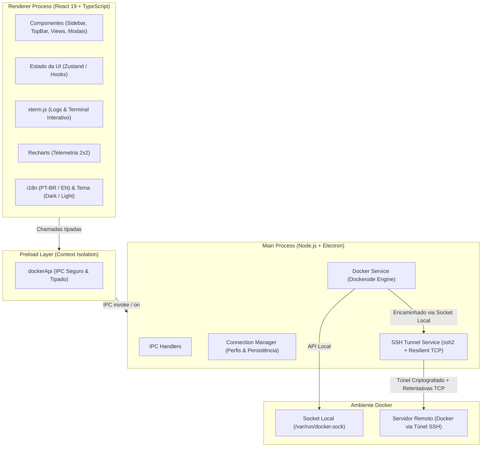

# DockDeck 🐳

> **Cliente desktop moderno, leve e multiplataforma para gerenciamento de containers Docker locais e remotos (via túnel SSH), combinando a agilidade do *lazydocker* com uma interface visual rica, gráficos de telemetria em tempo real e foco em produtividade.**

---

[](https://www.electronjs.org/)
[](https://react.dev/)
[](https://www.typescriptlang.org/)
[](https://tailwindcss.com/)
[](https://docs.docker.com/engine/api/)
[](LICENSE)

---

## 💡 A Ideia & Filosofia de Design

O **DockDeck** nasceu da necessidade de uma ferramenta que una o melhor de dois mundos: a agilidade, leveza e controle por teclado de ferramentas TUI (como o *lazydocker*) com a conveniência visual, gráficos dinâmicos e recursos interativos de uma aplicação desktop moderna.

Muitas ferramentas existentes para Docker pecam por dois extremos: ou são pesadas demais e exigem recursos excessivos da máquina, ou são exclusivamente de terminal, o que dificulta a análise de métricas comparativas e inspeções de estruturas JSON complexas.

O **DockDeck** resolve esse problema seguindo diretrizes rígidas de usabilidade:
1. **Consumo Enxuto de Recursos**: Construído com Electron, Vite e React 19 para inicialização instantânea e baixo uso de memória.
2. **Interface Direta e Intuitiva**: Botões, títulos de modais e ações priorizam termos de **uma única palavra** (*Start*, *Stop*, *Restart*, *Logs*, *Terminal*, *Salvar*, *Servidores*), reduzindo a carga cognitiva e acelerando o fluxo de trabalho.
3. **Suporte Nativo a Ambientes Remotos**: Conecte-se com segurança a instâncias Docker rodando em servidores em nuvem ou VPS via túnel SSH criptografado sem precisar expor a porta da Docker Engine diretamente para a internet.
4. **Fluxo Otimizado para Teclado**: Navegação por atalhos rápidos pensada para o dia a dia de desenvolvedores e times de DevOps.

---

## ✨ Funcionalidades

### 🌐 Gestão Multi-Host (Local & SSH Resiliente)
- **Detecção Local Automática**: Conecta diretamente ao socket Docker local (`/var/run/docker.sock` em Linux/macOS ou Named Pipe no Windows).
- **Túneis SSH com Conexão Resiliente**: Gerenciador de perfis para servidores remotos usando `ssh2`. Conta com pré-conexão TCP e retentativas automáticas, operando de forma estável mesmo em conexões de internet de alta latência ou com perda de pacotes.
- **Autenticação Flexível**: Suporte a chave privada (com/sem passphrase), senha tradicional e fallback para PAM interativo (`keyboard-interactive`).
- **Edição de Servidores**: Edição completa de perfis salvos com 1 clique (IP, porta, usuário e credenciais).
- **Alternância Instantânea**: Troque entre servidores locais e de produção com recarregamento em tempo real da lista de containers.

### 📊 Métricas & Telemetria em Tempo Real (Grade 2x2)
- **4 Gráficos Independentes**:
  - **CPU (%)**: Uso de processamento do container com cálculo de delta preciso do subsistema cgroups.
  - **Memória (MB)**: Consumo de memória ativa versus limite alocado.
  - **Rede (I/O)**: Tráfego de entrada (*Download*) e saída (*Upload*).
  - **Disco (I/O)**: Operações de leitura (*Read*) e escrita (*Write*).
- **Intervalos de Tempo Dinâmicos**: Seletor independente por gráfico para períodos de:
  - `30s` (30 segundos)
  - `1m` (1 minuto)
  - `5m` (5 minutos)
  - `15m` (15 minutos)
  - `1h` (1 hora)
  - `24h` (24 horas)
  - `3d` (3 dias)
  - `7d` (Semana)
- **Retenção Inteligente de Histórico**: Algoritmo de amostragem que preserva séries temporais de até 7 dias sem sobrecarregar a memória da aplicação.
- **Eixos com Hora Real**: Formatação em tempo real (`HH:mm:ss` para períodos curtos e `DD/MM HH:mm` para períodos estendidos).

### 📜 Visualizador de Logs Inteligente
- **Terminal com Cores ANSI**: Renderização fiel via `@xterm/xterm`.
- **Filtro e Busca Textual**: Encontre rapidamente erros, exceções ou eventos específicos.
- **Controles Úteis**: Alternância de rolagem automática (*auto-scroll*), seletor de linhas (*tail*: 50, 100, 250, 500, 1000) e limpeza de buffer.

### 💻 Terminal Interativo Integrado (Exec Shell)
- Acesso direto ao shell (`/bin/sh`, `/bin/bash` ou fallback automático) de qualquer container em execução diretamente pela interface.
- Redimensionamento automático de terminal (*fit addon*) e suporte a comandos interativos, cores e atalhos de terminal.

### 🔍 Inspeção Profunda de Containers
- Visualização categorizada com navegação por abas:
  - **Geral**: ID curto e completo, imagem, data de criação, status e comando de inicialização.
  - **Variáveis**: Relação completa de variáveis de ambiente (`ENV`).
  - **Volumes**: Mapeamentos de montagem (origem, destino, modo de leitura/escrita e tipo).
  - **Rede**: Endereços IP, gateway, portas expostas e redes conectadas.
  - **JSON**: Estrutura bruta da API Docker com botão de cópia com 1 clique para a área de transferência.

### 🎨 Temas & Internacionalização (i18n)
- **Dark Mode & Light Mode**: Interface moderna com paletas de cores adaptadas para alto contraste e conforto visual.
- **Multi-idioma**: Suporte nativo completo a **Português (PT-BR)** e **Inglês (EN)**.
- **Modal de Configurações**: Gerenciamento centralizado de idioma e tema com persistência imediata em `localStorage`.

### ⚡ Gestão do Ciclo de Vida
- Ações rápidas de container: `Start`, `Stop`, `Restart`, `Pausar` e `Remover`.
- Badges de status de alto contraste (`RUNNING`, `EXITED`, `PAUSED`) com tipografia nítida.
- Agrupamento inteligente por projetos Docker Compose.

---

## ⌨️ Atalhos de Teclado

Navegue e execute ações no DockDeck sem tirar as mãos do teclado:

| Tecla | Ação |
| :--- | :--- |
| <kbd>↑</kbd> / <kbd>↓</kbd> | Navegar pela lista de containers |
| <kbd>1</kbd> | Alternar para a aba **Métricas** |
| <kbd>2</kbd> | Alternar para a aba **Logs** |
| <kbd>3</kbd> | Alternar para a aba **Terminal** |
| <kbd>4</kbd> | Alternar para a aba **Inspecionar** |
| <kbd>R</kbd> | Reiniciar o container selecionado (*Restart*) |
| <kbd>S</kbd> | Parar o container selecionado (*Stop*) |
| <kbd>P</kbd> | Alternar entre pausar e despausar container |
| <kbd>Ctrl</kbd> + <kbd>R</kbd> | Forçar atualização da lista de containers |
| <kbd>?</kbd> | Exibir modal de atalhos de teclado |
| <kbd>Esc</kbd> | Fechar qualquer modal aberto |

---

## 🏗️ Arquitetura

O projeto adota uma arquitetura desacoplada e segura entre o processo principal do Electron e a camada de renderização:



---

## 🛠️ Stack Tecnológica

| Camada | Tecnologias Utilizadas |
| :--- | :--- |
| **Plataforma Desktop** | [Electron](https://www.electronjs.org/) + [electron-vite](https://electron-vite.org/) |
| **Interface do Usuário** | [React 19](https://react.dev/), [TypeScript](https://www.typescriptlang.org/), [Tailwind CSS v4](https://tailwindcss.com/) |
| **Componentes e Ícones** | [Lucide React](https://lucide.dev/), Tailwind Merge, Clsx |
| **Visualização de Dados** | [Recharts](https://recharts.org/) |
| **Emulação de Terminal** | [@xterm/xterm](https://xtermjs.org/), `@xterm/addon-fit` |
| **Comunicação com Docker** | [dockerode](https://github.com/apocas/dockerode) |
| **Comunicação SSH** | [ssh2](https://github.com/mscdex/ssh2) com pré-conexão TCP resiliente |
| **Testes** | [Vitest](https://vitest.dev/) |

---

## 📁 Estrutura de Diretórios

```
dockdeck/
├── src/
│   ├── main/                   # Processo Principal do Electron
│   │   ├── index.ts            # Ponto de entrada do app
│   │   ├── ipc/                # Handlers IPC de comunicação
│   │   └── services/           # Serviços (Docker, SSH resiliente, Perfis)
│   ├── preload/                # Script de pré-carregamento e ponte segura
│   │   └── index.ts
│   ├── renderer/               # Interface em React 19
│   │   ├── src/
│   │   │   ├── components/     # Componentes (Logs, Métricas, Terminal, Inspecionar, Modais)
│   │   │   ├── i18n/           # Dicionários de internacionalização (PT / EN)
│   │   │   ├── App.tsx         # Estrutura principal da tela e estados
│   │   │   └── main.tsx        # Inicialização do React
│   │   └── index.html
│   └── shared/                 # Tipagens e interfaces compartilhadas
├── tests/                      # Testes automatizados (Vitest)
├── electron.vite.config.ts     # Configuração de build (Vite + Electron)
└── package.json
```

---

## 🚀 Como Executar Localmente

### Pré-requisitos
- **Node.js** (versão 20 ou superior recomendada)
- **npm**, **pnpm** ou **yarn**
- **Docker Engine** em execução localmente

### 1. Clonar o repositório
```bash
git clone https://github.com/thiago-barros-souza/dockdeck.git
cd dockdeck
```

### 2. Instalar as dependências
```bash
npm install
```

### 3. Rodar em ambiente de desenvolvimento
```bash
npm run dev
```

### 4. Executar os testes automatizados
```bash
npm test
```

### 5. Gerar a compilação de produção
```bash
npm run build
```

---

## 🛡️ Licença

Este projeto está sob a licença [MIT](LICENSE).

---

Feito com ☕ e código por **[Thiago Barros](https://github.com/thiago-barros-souza)**.
